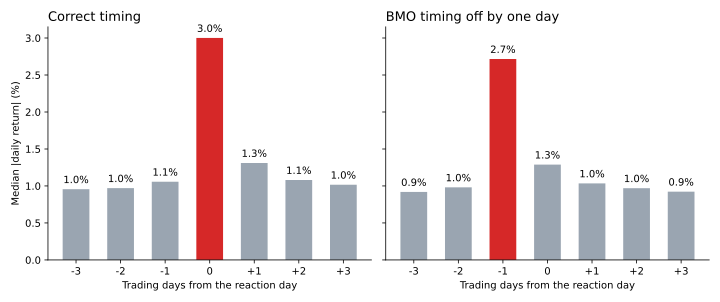

### Contents

### Overview & Introduction

My most recent project that I have been working on follows the hypothesis that if we can show that options misprice earnings moves, we can capitalize on such an error.
Before I could test this hypothesis, I first had to construct clean rows per earnings event. Little did I know that creating such rows would be almost all of the battle,
with constant hidden traps. The thing with these traps is that they're not the typical programming issue where the compiler or interpreter shouts at you; these errors just return
incorrect values, potentially disrupting your entire program without you having the slightest clue. In this post we will cover 6 of the traps I encountered during this project.

### Data & Setup
- The majority of the data in this project is sourced from [IVolatility](https://www.ivolatility.com/):
    - HV,
    - IVX,
    - IVS,
    - IVS by Delta,
    - Stock Prices,
    - Option Chains,
    - Earnings Calendar.
- [Wikipedia](https://en.wikipedia.org/wiki/S%26P_500) is used for current S&P 500 members.
- [S&P 500 Past Companies](https://github.com/hanshof/sp500_constituents).

### Glossary
- BMO: Before Market Open.
- AMC: After Market Close.
- Entry Day: The last close before the news.
- Reaction Day: The first close after the news.
- Split-adjusted price: Past prices divided by later splits, so returns are continuous.
- Lookahead: Using information you wouldn't have had at the time.

### The target: one clean row per event
The goal is a pandas DataFrame with one row per earnings event, holding:
- Company
- Report date
- Entry day and reaction day
- Stock prices on both days
- The price move
- The at-the-money straddle's prices (bid/mid/ask) on both days, and the implied move

Why rows per event instead of a daily time series? The question is about one specific moment, the earnings announcement, so each row should be exactly that moment.

### Trap 1: When Does the News Hit?
*Trap:* BMO reports react on the report day, whereas AMC reports react the next trading day. If you mix these timing codes up, you will end up reacting to an ordinary day instead of the earnings jump. This, as I previously warned, won't crash your code; instead, your information will be inaccurate. <br> <br>
*Fix:* Use a trading calendar from SPY's trading days. In my program I utilised the following code:
```python
import numpy as np
import pandas as pd


def trading_calendar(prices: pd.DataFrame) -> pd.DatetimeIndex:
    """Every day SPY traded = every US market day."""
    spy = prices[prices["ticker"] == "SPY"]
    dates = pd.DatetimeIndex(spy["date"].unique())
    return dates.sort_values()


def add_event_days(events, calendar):
    """Add entry_date and reaction_date to each event.

    BMO: the price reacts on the report date itself.
    AMC: the price reacts on the next trading day.
    """
    dates = events["report_date"]
    # first trading day ON or AFTER the report date
    pos_left = calendar.searchsorted(dates, side="left")
    # first trading day strictly AFTER it
    pos_right = calendar.searchsorted(dates, side="right")

    is_bmo = events["time_of_day_code"] == "BMO"
    reaction_pos = np.where(is_bmo, pos_left, pos_right)
    entry_pos = reaction_pos - 1

    events = events.copy()
    events["entry_date"] = calendar[entry_pos]
    events["reaction_date"] = calendar[reaction_pos]
    return events
```
Weekends and holidays roll forward for free: a Saturday report before Memorial Day reacts on the Tuesday. I checked this by using the median of the absolute value of the return around the reaction day. Day $0 = 0.030$ vs about $0.010$ on surrounding days; if timing were off by one, the spike would sit on day $-1$ or $+1$.


Day $0$ is the day the code labels as the reaction day. Left: with correct timing, the earnings move lands on day $0$. Right: treat BMO reports as AMC and the move lands a day before the code's reaction day, so the dataset records an ordinary day's move instead.

### Trap 2: Adjusted For What?
*Trap:* Stock prices are *split-adjusted* (past prices are divided by every later split), but option strikes are the real historical numbers. This causes two problems:
- **Strikes:** compare a 2015 strike with an adjusted price and you pick the wrong "at-the-money" strike, off by the split factor. For NVDA, the adjusted price in 2021 is 40× smaller than the real one (its 4× and 10× splits).
- **Market cap:** the stored market caps were computed from adjusted prices, so they are understated by every later split. Apple, January 2004: stored \$156M, actual about \$8.7B. The factor is 56 = 2 × 7 × 4, Apple's later splits.

*Fix:*
- **Strikes:** compare them with the **unadjusted** price, the real traded price that day.
- **Market cap:** multiply the stored value by the ratio of the unadjusted to the adjusted close on the entry day:

$$
M^{\text{corr}} = M^{\text{stored}} \times \frac{C^{\text{unadj}}}{C^{\text{adj}}}
$$

where $M$ is market cap, and $C^{\text{unadj}}$ and $C^{\text{adj}}$ are the unadjusted and split-adjusted closes. The ratio is exactly the later-split factor, so multiplying by it undoes the understatement.

*Lesson:* For every price-like column, ask: is it adjusted, for what, and as of when?

### Trap 3: A Ticker Is Not a Company
*Trap:* When working with stocks, you may have been under the assumption that each ticker is only assigned to one company forever, but in fact this is an incorrect assumption, as tickers are often reused; *e.g.* *WB* was initially used to represent Wachovia and now *WB* represents Weibo, and there are plenty of other examples of this. <br> <br>
*Fix:* To fix this, I implemented and utilised 3 columns, `company`, `ticker` and `symbol_at_date`, where `company` is the identity you join and group on, `ticker` is the folder or symbol the data was downloaded under, and `symbol_at_date` is what the company traded as on that date. <br>
*Reminder:* **Never** join or group by symbol, as you may mix 2 companies' data together.

### Trap 4: No Error Doesn't Mean No Gap
*Trap:* It's not uncommon for a company to rename itself, and with that, its ticker often changes; for example, *FB → META* and *ANTM → ELV*. I attempted to request under the old ticker, though unfortunately this returned 0 rows of data, confirming the old data had been restarted. Due to this lost data, in total the universe was missing about 3,700 events. <br> <br>
*Fix:* For renames that caused a restart in the tracking of an equity, you can use SEC EDGAR 8-K filings, keyed by a company ID that survives renames. <br>
*Lesson:* No error doesn't always mean data is not missing. Always compare where each dataset starts.

### Trap 5: Missing Is Not Zero
*Trap:* Where the bid was 0, IVolatility set the option price to 0 as well; this forced me to calculate the mid myself using the formula $\text{mid} = (\text{bid} + \text{ask}) \div 2$. There was also one instance of a row having an ask of 0, a missing value rather than a real price. Implied volatility was also capped at exactly 600%, with 1,528 cells at that cap; this led to the conclusion that these cells were placeholders, not real values. In IVX's price column, some of the cells had individual share values of up to \$60 billion. <br> <br>
*Fix:* Where volatility was at the cap, the value was replaced by NaN, alongside dropping the entire IVX price column and using the stock-price prices instead. <br>
*Lesson:* When looking at data, make sure to look at the max, min and the most common values of every column, as placeholders can be hiding.

### Sanity Rules: An Options Data Checklist
- *Rule:* bid $\leq$ ask <br> *Reason:* Otherwise you could buy and immediately sell for a profit.
- *Rule:* bid $\geq$ 0 <br> *Reason:* Bid = 0 means no buyers; you can't sell to nobody.
- *Rule:* mid = (bid $+$ ask)/2 <br> *Reason:* Vendor "prices" may hide rules.
- *Rule:* option price $\geq$ intrinsic value <br> (straddle $\geq$ |S − K|) <br> *Reason:* Otherwise it would be free money.
- *Rule:* expiry $\geq$ trade date, strike > 0, <br> type $\in$ {C, P} <br> *Reason:* Basic validity.
- *Rule:* one row per contract (company, date, expiry, strike, type) <br> *Reason:* Duplicates double-count.
- *Rule:* one underlying price per day <br> *Reason:* All quotes should share the same spot.
- *Rule:* use the IV solved from the contract's own price, not an interpolated one <br> *Reason:* An interpolated IV isn't a price anyone traded.

### Trap 6: Did You Know That Then?
*Trap:* Information leakage is one of the top reasons strategies perform well in backtests but fail in a live system. In this dataset we have the column `reported_earning`, which means it's very easy to introduce lookahead bias into any strategy we train on it if we're not careful. This is due to reported earnings not being available until after the event, and market cap on a BMO report date may already include that day's reaction. <br> <br>
*Fix:* To avoid lookahead bias, use the market cap from the previous event; we also dropped the entire `reported_earning` column when the calendar is loaded. <br>
*Lesson:* When utilising data, make sure to consciously think, and make sure it passes the question: "If I travelled to that exact time, would I have this information available to me?"

### Habits That Catch Silent Errors
1) Constantly check rows in and out, and then investigate exactly why those rows were removed.
2) Use known values and check that your program gives the correct values.
3) Make sure not only that your code is successful, but also that it fails when it should.
4) Compare any changes you make: if you update a function, check if the output is any different, and if so, figure out why.

### Questions to Ask of Any Dataset
1) When does the event actually hit the price?
2) What is each price adjusted for?
3) What identifies a company across time?
4) Where does each dataset start and end, and why?
5) Which values are placeholders?
6) Which columns weren't known at the time?

[](https://github.com/Ciaran-06/earningVol/tree/v1.0-kill-test)

### What's Next
With a clean dataset, the next step was to test the idea, and to write down how it would be judged before running it.