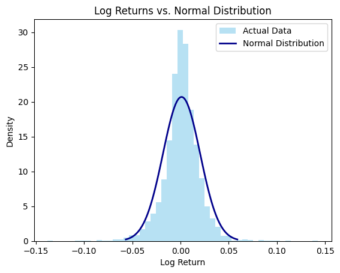
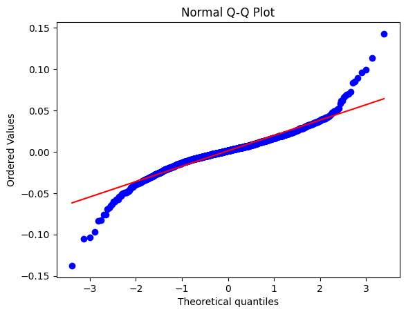
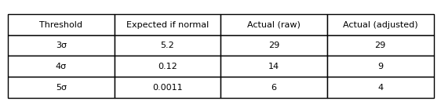

## The Question
It is common in models to simply assume that returns follow a simple normal distribution. In this post we will test this hypothesis and see if this belief holds true.

## Data
We will collect our data from Yahoo Finance, where the prices are adjusted for stock splits and dividend payouts. where number of samples is $N=1937$.
In this analysis data from AAPL will be used ranging from the start of 2019 through to the start of October 2026, we will be using the log returns of AAPL given by the formula,
$$
r_{t} = \ln \left(\frac{S_{t}}{S_{t-1}} \right)
$$
where $S_{t}$ is the daily closing price.

## How Wrong Is the Normal

To have a rough look at our assumption of returns following a normal distribution we shall plot a normal distribution given by,
$$
\mu = \frac{\Sigma r_{t}}{N}
$$ 
$$
\sigma = \sqrt{\frac{\Sigma (r_{t} - \mu)^2}{N}}
$$
$$
f(r_{t}) = \frac{1}{\sigma \sqrt{2 \pi}} \cdot e^{-\frac{1}{2} \left(\frac{r_{t} - \mu}{\sigma} \right)^2}
$$
where $f$ is the density of a normal distribution with the same mean and standard deviation as AAPL’s returns.

From this graph we can see that the returns don't entirely follow a normal distribution and the tail of the actual plotted returns stretch outwith the projected distribution. Now to more accurately depict the difference between the normal distribution and the actual we shall use a q-q plot,

where the red line is where the returns would be if the distribution was normal, and the blue line is where the return actually lies. This displays that AAPL's returns at the tail end are more extreme than a normal distribution would model.
$$
m_{k} =  \frac{1}{N} \space \sum^{N}_{t=1}{(r_t - \bar{r})^k} , \qquad \text{excess kurtosis} = \frac{m_{4}}{m^{2}_{2}} - 3
$$
If we compute the values of the excess kurtosis for our data set
$ \text{excess kurtosis} \approx 6.52 $

## Volatility's part in Kurtosis Value

In the last post we investigated volatility clustering and how there is regimes in volatility: with high turbulent days and low turbulence days, thus when we collect them together we end up with a mix of narrow and wide distribution, which will create fat tails in and of itself. If we were to take this into account by defining a volatility adjusted return,
$$
a_{t} = \frac{r_t}{\sigma _{t-1}}
$$
where $\sigma$ is our daily volatility calculated on a rolling 20 day window up to the previous day, and $r_t$ is the log returns of AAPL. If we now compute the kurtosis for the adjusted returns we get $\text{excess kurtosis} \approx 3.48 $.

## Results

As we have seen when we take into account volatility the excess kurtosis roughly halves from $6.52$ to $3.48$. So volatility clustering explains a large part of the fat tails. But even taking that into account the excess kurtosis is still well above 0, therefore showing even when taking volatility into account, extreme days occur far more often than a typical normal distribution would model. This is demonstrated in the table below.

We see that a normal distribution predicts 5 days of above $3 \sigma$ whereas in reality there is 29 days above it.
## Impact

This is an impactful point as many models such as the Black-Scholes-Merton assume normal returns, this could lead to unexpected risks to be taken, that are not traditionally accounted for by a standard normal distribution function.

## Limitations
 
- Data is only from one stock.
- The dataset includes the covid period which may lead to more extreme values.
- 20 day rolling window may impact results as shorter or longer one may lead to different excess kurtosis.

## Conclusion

Daily AAPL returns are not normal: excess kurtosis is about 6.5, against 0 for a normal distribution. Adjusting for volatility clustering roughly halves this, to about 3.5, but the tails remain fat, so extreme days occur more often than a normal distribution predicts even after accounting for changing volatility.
## Code

