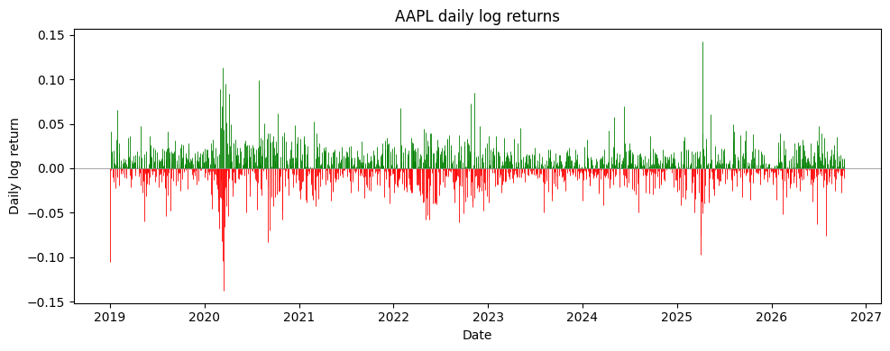
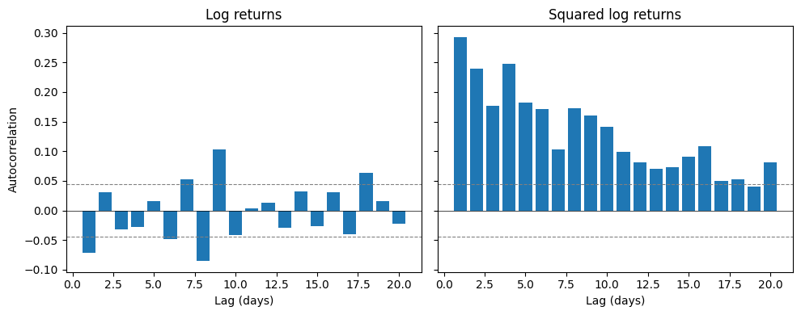

## The Question

Volatility clustering is the tendency for periods of high volatility to persist: turbulent days tend to be followed by more turbulent days, and calm days by calm ones. In other words, a big move today, in either direction, makes another big move tomorrow more likely.

This matters because many models, including the Black–Scholes–Merton model, assume volatility is constant. If volatility clusters, that assumption is violated. Volatility is not a fixed number; it changes over time, and in a way we can partly predict.

In this post we test whether clustering shows up in real data.

## Data

We use daily data for Apple (AAPL) from January 2019 to October 2026, sourced from Yahoo Finance. Prices are adjusted for stock splits and dividends, giving $N = 1934$ daily returns.

We work with log returns, defined as

$$
r_t = \ln\left(\frac{S_t}{S_{t-1}}\right)
$$

where $S_t$ is the closing price on day $t$.

We use log returns because they add up over time: the return over two days is simply $r_t + r_{t-1}$, whereas ordinary percentage returns have to be multiplied together. They are also the standard input to the models covered in later posts, such as GARCH.

The chart shows that big moves are not spread evenly through time; they bunch together. The two clearest clusters are March 2020 (the COVID crash) and April 2025 (the tariff sell-off).

## Measuring Clustering

To measure clustering, we use autocorrelation: how strongly a series is related to its own past.

$$
\rho(k) = \text{Corr}(r_t,\, r_{t-k})
$$

where $k$ is the lag in days.

Applied to returns $r_t$, $\rho(k)$ tells us whether the direction of past moves predicts future ones. But clustering is about the size of moves, not their direction, so we also apply $\rho(k)$ to squared returns $r_t^2$. Squaring removes the sign: a $-3\%$ day and a $+3\%$ day both become large positive numbers. If $r_t^2$ is autocorrelated, big moves tend to follow big moves, which is exactly what clustering means.

## Results

The dashed lines mark a band at

$$
\pm \frac{1.96}{\sqrt{N}} \approx \pm 0.045
$$

If returns were independent, each estimated autocorrelation would be roughly normally distributed around zero with standard deviation $1/\sqrt{N}$, so about 95% of bars would fall inside this band. A bar inside the band is therefore *consistent with* zero autocorrelation: too small to tell apart from random noise at the 95% level.

**Returns (left).** Almost all lags sit inside the band. The few that poke outside, such as lag 1 at about $-0.07$, are small. Past returns tell us very little about the direction of future returns.

**Squared returns (right).** The picture is completely different. The autocorrelation starts at about $0.29$ at lag 1, decays slowly, and is still above the band at lag 20. Big moves are followed by more big moves, and the effect lasts for weeks. Volatility clustering is real.

**A caveat.** The band itself assumes returns have constant variance, which is exactly the assumption we have just shown to be false. When volatility clusters, the true band is wider than $\pm 0.045$, so the few return lags just outside it are weaker evidence than they look. For squared returns, the short lags sit several times above the band, so the conclusion does not depend on its exact width.

## Why This Matters

Volatility clustering matters as models such as the Black-Scholes-Merton assume a constant $\sigma $ where as we have just seen volatility moves in regimes.
We can also take from this that volatility is forcastable as models such as GARCH can be used to forcast $\sigma $ from yesterday's shock and variance:
$$
\sigma_{t}^2 = \omega + \alpha r_{t-1}^2 + \beta \sigma_{t-1}^2
$$
Since volatility is not a constant using one long-term value for $\sigma$ can cause stratigies to underestimate risk during high volatility regimes.

## Limitations
- Only one stock (AAPL) was used and for one period.
- Autocorrelation only captures linear dependence.
- Robustness: The dataset includes the COVID period which may sqew results.

## Conclusion

For AAPL from 2019 to 2026, returns themselves show almost no autocorrelation, but squared returns show strong and persistent autocorrelation, starting at about $0.29$ and still significant after 20 days. Volatility clustering is real: big moves follow big moves. Models that assume constant volatility will misjudge risk when markets turn turbulent.
## Code

